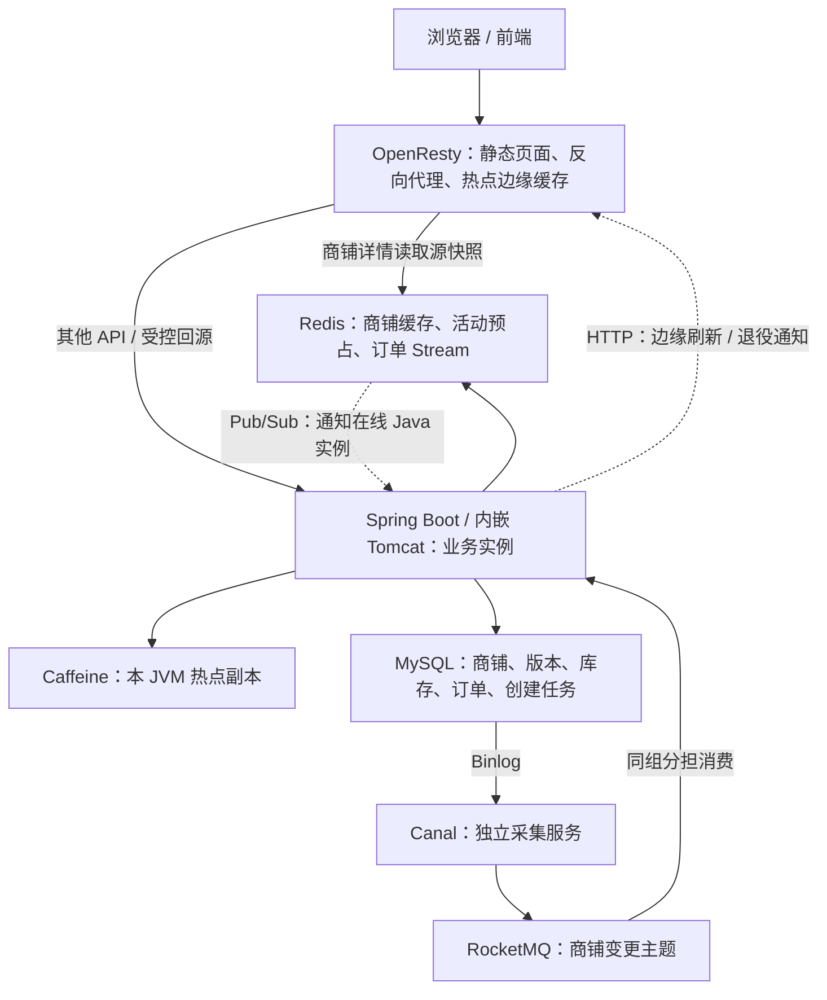
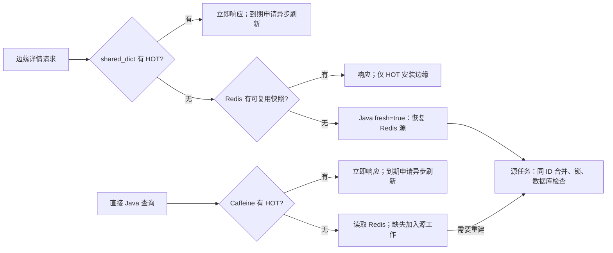
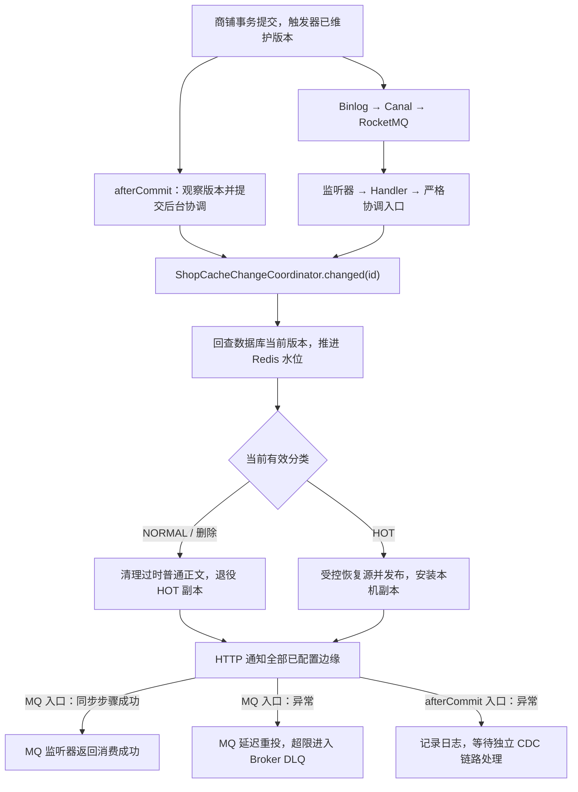
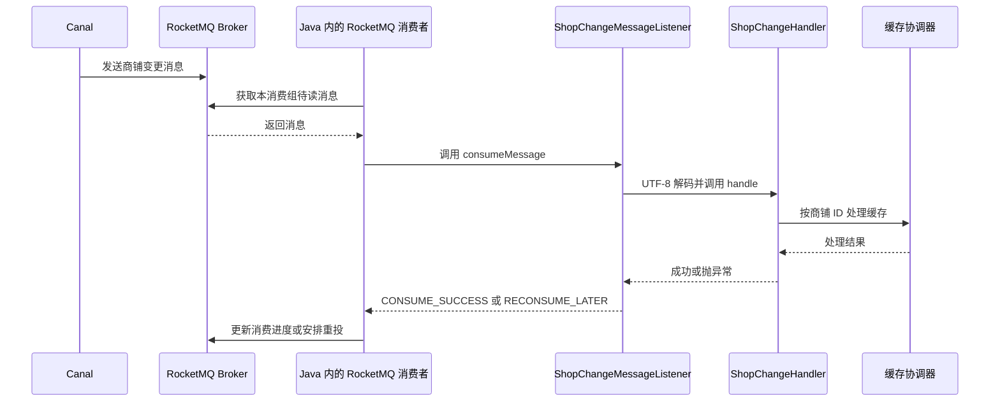
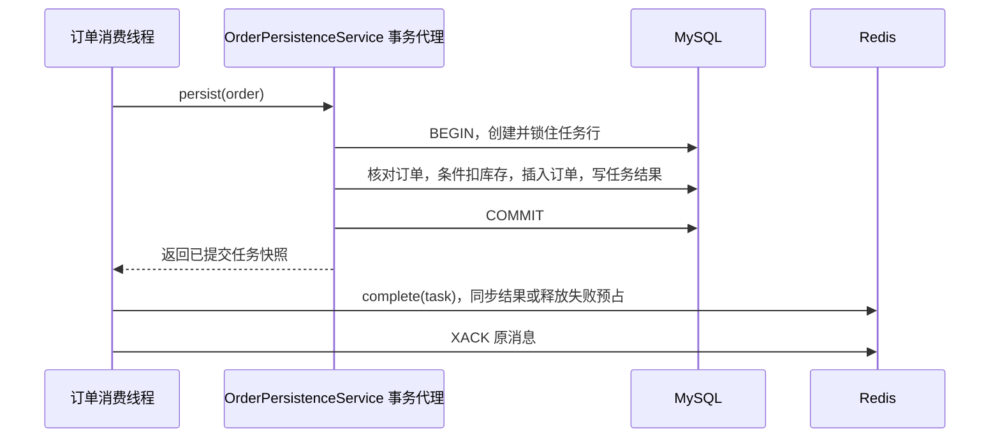
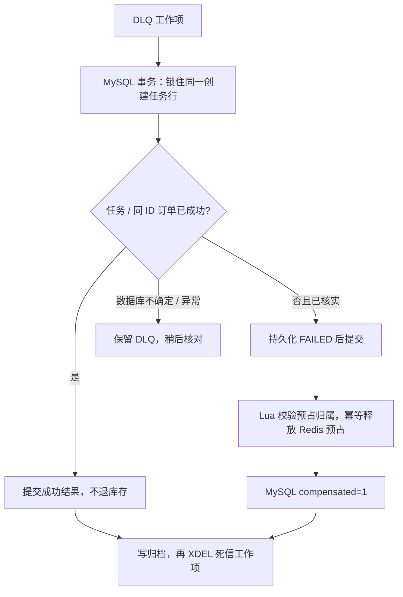

# 点评项目核心业务设计与技术实现

本文围绕三个核心展开：

    商铺信息查询的多级缓存

    Canal + RocketMQ 缓存同步

    秒杀订单异步处理与失败补偿。

每部分按“业务需要什么 → 为什么这样设计 → 数据如何组织 → 代码如何执行 → 并发和失败如何处理”说明。

部署命令见[本机部署与联调手册](../部署/本机部署与联调手册.md)，测试过程、数据及原理见[性能与可用性测试手册](../测试/性能与可用性测试手册.md)。

## 目录

1. [业务范围与总体架构](#overview)
2. [技术选型与职责划分](#technology)
3. [商铺缓存的数据模型与冷热分类](#cache-model)
4. [缓存期限、容量与启动预热](#cache-lifecycle)
5. [商铺查询的完整执行路径](#shop-query)
6. [内部回源接口与并发重建](#internal-shop-cache)
7. [Canal + RocketMQ 缓存一致性](#cache-consistency)
8. [秒杀受理与订单状态模型](#order-acceptance)
9. [Stream 消费与数据库事务](#order-persistence)
10. [Pending 恢复、死信与失败补偿](#order-recovery)
11. [一致性保证、故障边界与人工处理](#reliability)

## 一、业务范围与总体架构

### 1.1 三个核心分别解决什么问题

| 核心         | 业务诉求                                                 | 主要矛盾                                                               | 当前设计                                                                                      |
| ------------ | -------------------------------------------------------- | ---------------------------------------------------------------------- | --------------------------------------------------------------------------------------------- |
| 商铺详情查询 | 用户快速打开商铺，热点访问集中时仍可返回                 | 数据库承受不了每次详情读取；集中失效可能造成瞬时回源                   | 普通商铺只缓存 Redis；热点商铺在边缘、Redis、Java 本地保留快照，逻辑到期后异步刷新            |
| 商铺缓存同步 | 商铺修改后，各层逐步看到新值；直接 SQL 修改也能被感知    | 数据库与缓存无法通过一个普通事务同时提交；存在失败、重复和迟到通知     | 提交后尽力协调，加上 Canal 采集 Binlog、RocketMQ 重试；版本保护写回，缓存期限提供查询恢复机会 |
| 秒杀订单     | 在库存约束下受理抢购，后台创建订单，最终能查询成功或失败 | 大量并发直接操作数据库；受理后写库可能失败；重复消费或补偿可能破坏库存 | Redis Lua 原子预占并写 Stream，后台事务落库；Pending 恢复、持久化失败记录、幂等释放预占和归档 |

商铺详情允许短暂读取旧信息，以降低响应延迟。

秒杀库存和购买资格属于交易约束，必须在 Redis 与 MySQL 各自的操作边界内保护。

### 1.2 服务如何协作



图中实线为主要取数或消息传递关系，虚线为缓存通知；不是一次请求必须走遍的顺序。

- **边缘实例**是运行 OpenResty 的一个服务部署，兼具反向代理和缓存能力。一个实例可以有多个 Nginx worker，共享本实例的 `shared_dict`；不同机器或独立服务实例的字典不共享。
- **Java 实例**是运行业务 JAR 的一个进程。进程内有 Tomcat 请求线程、缓存刷新线程、订单消费线程等。每个 JVM 的 Caffeine 都是独立副本。
- **Redis**由多个业务实例共享；逻辑库编号隔离键空间，不等于独立服务或独立故障域。
- **MySQL**保存最终业务事实；Redis 商铺快照并不替代商铺表，Redis 受理记录也不等于订单已提交。

### 1.3 本项目的其他业务

项目还有登录、签到、关注、笔记、Feed、商铺分类和 GEO 距离查询。

## 二、技术选型与职责划分

### 2.1 为什么采用这些组件

| 组件                     | 在本项目中的落点                                         | 选择理由与代价                                                                         |
| ------------------------ | -------------------------------------------------------- | -------------------------------------------------------------------------------------- |
| JDK 21                   | Maven `release=21`；使用 record、Stream、switch 表达式等 | 用统一语言版本组织实现；JDK 版本统一不表示所有依赖都升级到了最新版本                   |
| Spring Boot 2.7.18 / MVC | 依赖注入、HTTP、事务代理、生命周期回调                   | 复用原工程体系；当前并发方案使用普通线程池，没有因为 JDK 21 就自动采用虚拟线程         |
| MySQL / InnoDB           | 真实业务表、版本表、创建任务表、行锁与唯一约束           | 把最终事实和并发约束放在持久化数据库；高并发受理不能全部同步压给它                     |
| Redis                    | 缓存、原子 Lua、库存预占、Stream、Pub/Sub                | 项目已有依赖，网络共享和原子执行便于多个实例协作；持久化、容量及单点故障需要单独评估   |
| Caffeine                 | JVM 内的热点快照                                         | 命中时不需要网络；各 JVM 独立，必须接受通知或在逻辑到期后刷新                          |
| OpenResty                | Nginx 请求阶段运行 Lua，直接读共享字典和 Redis           | 热点响应可以在进入 Java 前完成；引入 Lua 协议、容量和跨实例通知维护成本                |
| Redisson RLock           | 跨 JVM 的商铺源重建锁                                    | 提供等待、所有权和 watchdog 续租；仍需发布版本校验，锁不能代替数据新旧判断             |
| Canal                    | 独立读取 MySQL Binlog                                    | 覆盖绕过 Java 的数据库修改，业务代码不用自己实现复制协议；依赖位点、日志保留和采集配置 |
| RocketMQ                 | 持久化商铺变更事件、分担消费、消费重试与 Broker 死信     | 把采集和缓存处理解耦；消息可能重复，需要业务幂等及积压/死信诊断                        |
| Jackson                  | Java 对象、缓存 JSON、HTTP JSON 之间的转换               | 使用同一个 Spring `ObjectMapper`，减少不同序列化规则造成的兼容问题                     |

具体版本以 [pom.xml](../../pom.xml) 为准。当前项目 RocketMQ Java 客户端为 4.9.8，本机既有部署记录中的 Broker 为 5.3.3，二者是不同层面的版本。

<a id="message-selection"></a>

### 2.2 为什么订单用 Stream，缓存同步用 RocketMQ，通知其他 Java 实例用 Redis Pub/Sub

1. **订单用 Stream：方便预占和入队一起完成。** 库存预占、订单消息写入放在同一个 Redis Lua 中，减少“库存扣了、消息却没发出去”的风险；代价是项目自己管理 Pending、重试和补偿。

2. **缓存同步用 RocketMQ：需要可靠地处理数据库变更。** Canal 已支持直接投递 RocketMQ，利用消息持久化、同组分担消费、失败重试和死信处理，让缓存协调失败后还能继续处理。

3. **本地通知用 Pub/Sub：需要提醒每个在线 JVM。** 各 JVM 的 Caffeine 独立，需要广播刷新提醒。Pub/Sub 简单轻量；允许漏通知后短暂读旧值，由后续查询发现本地逻辑到期再触发刷新。

4. **可以统一到 RocketMQ，但要增加配套设计。** 订单要解决 Redis 预占与 MQ 发送之间的衔接，本地通知要解决每个实例都能收到。当前根据这三种需求分别选型，而不是认为 RocketMQ 做不到。

### 2.3 用一次热点商铺修改把两层通知串起来

以直接 SQL 修改固定热点10号商铺、共享源尚未被其他请求更新的情况为例：

```text
MySQL 修改已提交
  → Canal 采集 Binlog 并投递 RocketMQ
  → 同组某个 Java 实例消费，调用 changed(10)
  → 共享 Redis 源更新，同时 PUBLISH 本地副本提醒
      → 各在线 JVM 保留旧热点值，标记到期并申请异步刷新
  → 消费实例向配置的 OpenResty 发送 HTTP 通知
      → 边缘检查当前源，触发刷新或处理退役
  → 本次处理无异常，监听器返回 CONSUME_SUCCESS
```

图中的副本刷新是异步的，可以与后面的步骤交错；RocketMQ 成功返回不等待所有副本刷新结束。若配置的边缘端点通知失败，本次 MQ 消费返回重试；若某个 JVM 漏掉 Pub/Sub 提醒，没有逐实例 ACK 能把这次漏通知反馈给 MQ。两种失败的处理方式不同，不能把“可靠消费了数据库变更”说成“所有缓存副本都可靠地收到了通知”。

## 三、商铺缓存的数据模型与冷热分类

### 3.1 项目当前使用固定热点/普通商铺分类

`hmdp.cache.hot.ids` 是固定热点 ID 名单，默认 `10`。`ShopCacheCatalog` 启动时校验、去重并冻结名单，其余 ID 都按普通商铺处理。

当前不根据访问量自动升温，不提供运行时冷热切换，不根据 JSON 是否含过期字段猜测类型。固定分类减少了策略阶段、双路由和切换恢复的复杂度，使核心集中在多级查询、受控回源与缓存同步。

实际有效类型由下式推导：

```java
return !version.deleted() && isHot(version.shopId())
        ? CacheMode.HOT : CacheMode.NORMAL;
```

固定 HOT 商铺删除后，名单仍保留它的 ID，但当前有效路由变为 NORMAL，用于清理正向热点副本和保存短期不存在占位。重新插入相同 ID 后，又按固定名单成为 HOT。这里的 NORMAL 不只表示普通商铺，也包含“已不存在，不能继续当作热点正值使用”的情况。

代码：[ShopCacheCatalog](../../src/main/java/com/hmdp/cache/ShopCacheCatalog.java)。

### 3.2 MySQL 为什么需要版本表

1. **区分新旧数据，防止旧值覆盖新值。** 版本表记录商铺ID、递增版本号和删除状态。缓存发布时根据已知版本拒绝迟到的旧任务，避免旧快照覆盖新快照；冷热分类仍由固定名单决定。

2. **让版本跟着数据库修改一起变化。** 通过触发器在商铺增删改时维护版本，与商铺修改处于同一MySQL事务，因此应用更新和直接执行SQL都能推进版本，不必依赖业务代码手动维护。

3. **删除商铺后仍保留版本记录。** 删除时标记deleted=1，版本继续递增；以后重新插入相同ID，也从原版本继续增加，避免新商铺与历史旧数据的版本混淆。

4. **版本保护不等于强一致。** Redis尚未感知数据库的新版本时，仍可能短暂写入旧缓存，需要提交后协调、Canal同步或到期重建来修正，整体仍是最终一致。

### 3.3 Redis 保存哪些键

| 键                          | Redis 类型       | 内容                                                    |
| --------------------------- | ---------------- | ------------------------------------------------------- |
| `cache:shop:v3:meta:<id>`   | Hash             | `id`、`revision`、`mode`、`deleted`，用于路由和版本水位 |
| `cache:shop:v3:normal:<id>` | String           | 普通快照或不存在占位的 JSON                             |
| `cache:shop:v3:hot:<id>`    | String           | 热点快照 JSON，无物理 TTL                               |
| `lock:shop:rebuild:v3:<id>` | Redisson 锁 Hash | 当前持锁者及重入信息，不是商铺正文                      |
| `cache:shop:v3:catalog`     | String           | 固定名单和源逻辑期限的配置指纹                          |

### 3.4 ShopCacheSnapshot、ShopCacheView 与各层实际存储形式

[ShopCacheSnapshot](../../src/main/java/com/hmdp/cache/ShopCacheSnapshot.java) 是 Redis 源快照的数据结构：

```java
public record ShopCacheSnapshot(
        String id,
        CacheMode mode,
        String revision,
        long logicalExpireAtEpochMillis,
        boolean missing,
        String dataJson) { /* 判断逻辑过期及是否可进入热点上层缓存 */ }
```

示意 JSON：

```json
{
  "id": "10",
  "mode": "HOT",
  "revision": "8",
  "logicalExpireAtEpochMillis": 1800000000000,
  "missing": false,
  "dataJson": "{\"id\":10,\"name\":\"示例商铺\"}"
}
```

`dataJson` 本身是商铺 JSON 文本，外层快照还包含缓存控制信息。商铺时间字段属于业务数据；过期判断仅使用毫秒时间戳，避免依靠日期字符串解析。

[ShopCacheView](../../src/main/java/com/hmdp/cache/ShopCacheView.java) 为快照再附加本层期限：

```java
public record ShopCacheView(
        ShopCacheSnapshot snapshot,
        long localLogicalExpireAtEpochMillis) { }
```

它区分 Redis 的 30 分钟源期限和本地/边缘的 5 秒副本期限。

| 位置      | 键与值的具体形态                                                                                                             |
| --------- | ---------------------------------------------------------------------------------------------------------------------------- |
| Redis     | 字符串键 → 外层快照 JSON 字符串                                                                                              |
| Caffeine  | `Cache<Long, ShopCacheView>`，Long 键 → JVM 中的 Java 对象，不对整个 View 再做 JSON 序列化；对象内部的 `dataJson` 仍是字符串 |
| OpenResty | shared_dict 中字符串 ID → 编码后的条目字符串；条目包含必要快照元信息、局部期限及预先拼好的 HTTP 响应文本                     |

边缘不再重复保存完整 `dataJson` 和响应两份正文。响应直接复用 Jackson 生成的商铺 JSON 文本，避免 Lua 解码再编码业务字段时损失大整数精度或改变日期格式。ID、revision 在快照控制协议中使用字符串。

“缓存序列化与 HTTP 返回共用 Jackson”指 Java 使用同一个 Spring `ObjectMapper` 处理 JSON 转换，不表示缓存协议和公开接口字段完全相同。公开详情返回 `Result`，内部接口返回 `ShopCacheView`。

<a id="cache-lifecycle"></a>

## 四、缓存期限、容量与启动预热

### 4.1 当前期限配置

| 数据                             | 物理期限                       | 逻辑期限     | 到期行为                                 |
| -------------------------------- | ------------------------------ | ------------ | ---------------------------------------- |
| 普通商铺 Redis 正文              | 1800 秒                        | 无           | 键消失后，查询同步等待受控回填           |
| 不存在占位                       | 120 秒                         | 无           | 到期后重新核对数据库，避免永久记住不存在 |
| 热点 Redis 源快照                | 无，正常 `TTL=-1`              | 默认 1800 秒 | 返回旧值，触发异步源重建                 |
| 热点 Caffeine 副本               | 不配置按时间过期               | 默认 5 秒    | 返回旧值，申请本地后台刷新               |
| 热点边缘副本                     | `safe_set(..., 0)`，无物理 TTL | 默认 5 秒    | 返回旧值，注册后台 timer 刷新            |
| 真实商铺/删除记录的 Redis 元数据 | 无                             | 无           | 通过版本观察推进，不按时间清除           |
| 从未登记的不存在 ID 元数据       | 120 秒                         | 无           | 避免任意无效 ID 形成永久元数据           |

普通正文 1800 秒、不存在占位 120 秒目前写在 `ShopRedisStore.publish()` 的参数中；热点源期限和本地期限来自配置。边缘期限来自自己的环境变量，部署时需要与 Java 的设计值保持一致。

### 4.2 为什么热点不用物理过期

热点的主要目标是在集中访问时始终保留可返回的旧值。逻辑到期表示“应当刷新”，不表示“删除数据”。如果同时让热点正文自动消失，到期时仍可能使一批请求一起等待回源。

因此热点在三层都只使用正文内的逻辑期限；普通商铺不占据上层常驻空间，Redis 用物理 TTL 控制整体缓存规模。不存在结果也不会常驻热点上层。

无物理 TTL 不意味着数据绝不会丢失：进程重启、Redis 数据丢失、显式删除、容量或配置问题仍可能造成缺失。真正缺失时，另有 Future 合并和分布式互斥保护。

### 4.3 为什么上层 5 秒、Redis 30 分钟

1. **上层为什么设5秒？** 这是一个在Redis访问流量与缓存数据新鲜度之间取舍得到的数字。ttl越短，核对Redis越频繁，但漏通知后能更早发现新值，即通过短逻辑期限兜底漏通知或副本刷新失败。ttl越长，对下层缓存的压力就越小，但是可能会出现更长时间的旧数据窗口。

2. **Redis为什么设30分钟？就不怕缓存未及时同步会导致三十分钟的时间窗口内读到的都是旧数据吗？** 正常更新依靠提交后协调和Canal＋RocketMQ，不必等30分钟；较长的期限是最后回源兜底，主要考虑：

   - **核对成本不同。** 上层之后还有Redis做缓冲；但是Redis之后直接就是MySQL，过短的期限会让有访问的商铺频繁回源，增加数据库压力。
   - **失败恢复方式不同。** MQ消费过程中的Redis源更新异常，可以通过借助MQ可靠的消费重试机制继续处理；但是各JVM的Caffeine副本通过Redis Pub/Sub异步刷新，失败不会反馈给原MQ消费者，因此更依赖短逻辑期限补救。

### 4.4 期限什么时候变化

**成功刷新或重建哪一层缓存，就重新计算哪一层的过期时间；单纯命中查询不会续期。**

例如，上层从Redis刷新只重新计算本层期限，不延长Redis源期限；刷新失败不会给旧数据续期。

### 4.5 如何让固定热点尽量常驻

当前项目设计中固定 HOT 最多 500 家，Caffeine `maximumSize=1000`，边缘正文 10 MiB。

只有有效 HOT 正值进入上层，普通流量不会挤占这些条目。

Caffeine 仍然具有容量淘汰机制，当前通过固定热点名单约束，使正常业务不触及它的淘汰边界。

### 4.6 启动预热

1. Java 的 `ShopCacheBootstrap` 在应用就绪事件中，把版本表中的事实观察到 Redis。
2. 遍历固定名单，对当前存在的 HOT 调用 `source.await()`，恢复 Redis 源并安装本机 Caffeine。
3. OpenResty 的 worker 0 在启动时通过 `ngx.timer.at(0, warm_all)` 执行一次名单预热。
4. `warm_all` 请求 Java 的 `/internal/shop-cache/hot`，再逐个使用 `fresh=true` 取快照并安装边缘。

## 五、商铺查询的完整执行路径

### 5.1 先区分公开边缘入口与直接 Java 入口

| 入口                                        | 用途                    | 缓存起点                                            |
| ------------------------------------------- | ----------------------- | --------------------------------------------------- |
| `GET :8080/api/shop/{id}`                   | 浏览器访问 OpenResty    | shared_dict，之后 Redis，必要时调用 Java 内部源接口 |
| `GET :8081/shop/{id}`                       | 直接访问 Java 公开详情  | Caffeine，之后 Redis，必要时受控回源                |
| `GET /internal/shop-cache/{id}?fresh=false` | 内部读取 View，默认分支 | 与 Java 查询共用响应优先路径                        |
| `GET /internal/shop-cache/{id}?fresh=true`  | 严格恢复 Redis 源       | 直接加入源重建工作，不被 Caffeine 命中短路          |

OpenResty 对商铺详情有单独的 Lua `location`；其他 `/api/` 通常去掉前缀后反向代理到 Java。

### 5.2 边缘热点命中

1. `shop.lua` 校验商铺 ID 和请求方法。
2. `cache.peek(id)` 从本实例共享字典取出 HOT 条目。
3. 未逻辑到期：直接输出已保存的响应文本。
4. 已逻辑到期：`cache.schedule(id)` 争抢共享刷新标记，获胜者注册一次异步回调；当前请求仍返回旧响应。

**异步回调主要做三件事：** 再次检查边缘是否还需要刷新；优先读取Redis中的有效热点快照，不可用时请求Java核对或重建源；最后检查版本并更新边缘副本，重新计算本层逻辑期限。商铺已删除则清理旧副本，刷新失败则保留旧值、短暂退避，结束时释放本次刷新标记。

当前请求只返回边缘已有结果，不等待上述Redis读取或Java回源。

响应头 `X-HMDP-Cache: shared` 表示本次正文来自边缘；`X-HMDP-Cache-Stale: true` 表示当前已知需要刷新，不代表请求失败。

### 5.3 边缘缺失后读取 Redis

`hmdp_cache.read_redis()` 在一次 Redis Lua 调用中读取路由和对应快照。

| Redis 结果           | 前台行为                 | 后台行为                       | 是否填边缘                |
| -------------------- | ------------------------ | ------------------------------ | ------------------------- |
| NORMAL 正文有效      | 返回正文                 | 无                             | 否                        |
| NORMAL 正文版本落后  | 返回旧正文               | `schedule_normal()` 严格刷新源 | 否                        |
| HOT 正文有效         | 返回并尝试安装边缘       | 无                             | 是                        |
| HOT 正文到期或落后   | 返回旧值，局部期限设为 0 | `schedule()` 刷新              | 是，仍受版本/容量检查     |
| 元数据或可用快照缺失 | 等待 `fresh=true`        | 共享源工作                     | 仅返回的有效 HOT 可以安装 |

两个调度函数都先争抢各自的共享刷新标记，再注册一次性异步回调；当前请求不等待后台任务。区别是：

1. **`schedule()`维护热点边缘副本。** 回调`refresh()`先检查边缘是否已被其他任务刷新，再优先复用Redis有效热点快照；源缺失、逻辑到期或版本落后时，调用Java的`fresh=true`接口核对或重建源，之后更新边缘副本。商铺已删除时清理旧热点。

2. **`schedule_normal()`修复普通Redis源。** 回调`refresh_normal()`先重新读取Redis；普通源版本已跟上就结束，否则调用Java的`fresh=true`接口完成源回填。它不把普通正文写入边缘或Caffeine，也不会仅因读到旧值就延长旧TTL；成功重建后才设置新正文的TTL。

**简记：`schedule()`主要让热点边缘副本跟上源，`schedule_normal()`主要让普通Redis源跟上数据库。** 两者的回调执行失败时都会退避并释放本次标记，由后续查询再次触发。

### 5.4 直接 Java 查询

`ShopController → ShopServiceImpl.queryById → ShopCacheService.get → view`：

```text
hot.cached(id)
  有 Caffeine HOT：立即返回；到期只申请后台刷新
  没有：store.version(id) 读取 Redis 元数据
      元数据缺失：source.await(id)
      有效类型 HOT：hot.get(id, version)
      有效类型 NORMAL：normal.get(id, version)
```

`store.version()` 访问 Redis Hash，不能与 `repository.version()` 的 MySQL SELECT 混淆。

- `hot.get()` 读取 Redis HOT；有旧值就返回，源过期/落后则申请后台任务；真正缺失才同步等待源。
- `normal.get()` 读取 Redis NORMAL；旧版本可返回并申请后台任务；不可复用时同步等待源。
- `wrap()` 生成 View，只有 `snapshot.cacheableHot()` 才安装 Caffeine。
- 最后由 Jackson 把 `dataJson` 还原为 `Shop`，包装成公开 `Result`。

因此，**有效缓存命中的常规 Java 查询不会为了确认新鲜度主动查询 MySQL 版本表**。

### 5.5 为什么边缘链路通常不经过 Caffeine



Caffeine 服务于进入 Java 的详情请求，不要求所有边缘请求都专门绕经它。

## 六、内部回源接口与并发重建

### 6.1 内部回源接口参数 fresh 的业务含义

`fresh=false` 的含义是响应优先，有符合规则的旧值就可以返回。`fresh=true` 的含义是进入严格源工作。

`fresh=true` 主要用于边缘真缺失、后台源恢复和启动预热。源任务成功拿到重建锁后会执行 MySQL 版本检查，所以不适合作为每次缓存命中的必经接口。

### 6.2 为什么先做同 JVM 请求合并

同一商铺瞬间有 100 个缺失请求，若全部各自抢 Redis 锁，虽然数据库可能被保护，网络、锁等待及线程仍然浪费。

`ShopCacheSource.loading` 使用：

```java
ConcurrentHashMap<Long, CompletableFuture<ShopCacheSnapshot>> loading;
```

ConcurrentHashMap模拟提交回源任务的锁，putIfAbsent(id, candidate)原子登记模拟抢锁。

CompletableFuture是一个未来结果容器：第一个请求抢到锁提交源任务，其余请求等待已有 CompletableFuture中的未来结果。

```text
请求 A ──登记成功──> 源线程执行 loadLocked ──complete(快照)──┐
请求 B ──取得同一 Future──get(各自剩余预算)──────────────────┤ 唤醒等待者
请求 C ──取得同一 Future──get(各自剩余预算)──────────────────┘
```

正常完成用 `complete(snapshot)`；任务失败用 `completeExceptionally(error)`，等待者得到异常结果。`finally remove(id, candidate)` 只删除本次登记，避免误清后来任务。

等待者执行 `get(timeout)` 仍是阻塞等待的 Java 调用，整个 MVC 接口没有因此变成异步 Servlet。它的价值是共享一份工作与结果。

### 6.3 await 的关键处理阶段

1. **合并同商铺的源任务。** 校验 ID，并为本次调用计算默认 2 秒等待预算；在 `loading` 中登记或复用同 ID Future，只有登记成功者向源线程池提交任务。
2. **等待共享结果。** 在各自预算内等待 Future，预留约 100ms 给最后一次读取；成功则返回快照。单个等待者超时不会取消共享任务，中断则恢复中断标记并受控失败。
3. **最后读取 Redis 或受控失败。** 等待超时或源任务异常后，`finalReadOrFail()` 用独立小线程池在剩余预算内读取 Redis 版本和快照；若已有有效源就返回，否则抛出 `CacheBusyException`，由 HTTP 层返回 503，不再让等待者各自直接查库。

### 6.4 loadLocked：跨实例互斥与二次检查

`ShopCacheSource.loadLocked()` 在实际源工作线程内执行，主要分为三个阶段：

1. **获取跨实例重建锁。** 对商铺对应的 RLock，在剩余预算内等待拿锁，避免多个 Java 实例同时重建；不指定固定租期，由 Redisson watchdog 续租。
2. **拿锁后二次检查。** 查询 MySQL 当前版本并推进 Redis 元数据，再检查 Redis 快照的分类、版本、存在状态和逻辑期限；若别人已经完成有效回填，直接复用。
3. **回源并安全发布。** 快照不可用时，联查版本表与商铺表构造新快照，通过 Lua 校验版本和锁归属后写入 Redis，防止旧任务覆盖新缓存。

发生版本竞争时最多尝试三轮检查与发布；失锁或预算耗尽则受控失败，结束时仅由仍持锁的线程解锁。

### 6.5 requestRefresh：热点副本异步刷新

`HotShopCacheService.requestRefresh(id)` 在 Caffeine 逻辑到期、读到过期或版本落后的热点源快照、收到热点变更通知时申请后台刷新；已有旧值的查询不等待这次刷新完成。

1. **控制重复申请。** 先检查 `retryAfter` 是否仍在失败退避期，再用 `refreshing.putIfAbsent(id, marker)` 抢占本 JVM 的刷新标记；同一商铺只有获胜请求提交线程池任务，其余请求直接返回。
2. **后台二次检查。** 工作线程读取 Redis 版本元数据，缺失时交给 `source.await()` 恢复；已删除或不在固定热点名单内则按版本退役本地副本。若本地副本已被其他任务更新、逻辑未过期且版本不落后，就结束本次任务。
3. **读取源并更新副本。** 通过二次检查后，增加刷新尝试计数；优先复用 Redis 中的有效快照，不可用时调用 `source.await()`，按 6.3、6.4 受控恢复源。随后重新计算本层逻辑期限，并通过版本、容量检查安装热点副本；普通快照和空值不存入 Caffeine。
4. **清理标记并处理失败。** 工作线程在 `finally` 中用 `remove(id, marker)` 清理本次标记。刷新异常保留旧快照并退避 500ms；线程池拒绝任务时也清理标记，退避 100ms，避免高并发下反复提交。

这里没有定时器主动重试，退避结束后仍需后续查询或事件再次调用 `requestRefresh()`。`refreshes` 只统计刷新尝试次数，不代表成功次数，也不是重试次数上限。

普通商铺的同名方法 `NormalShopCacheService.requestRefresh()` 采用相似的标记、二次检查和退避机制，但只恢复 Redis 源，不安装 Caffeine 副本。

## 七、Canal + RocketMQ 缓存一致性

### 7.1 缓存同步架构链路

1. **afterCommit：尽快同步。** 业务接口更新商铺并提交事务后，先推进 Redis 版本水位，再提交后台任务，执行普通缓存失效、热点缓存重建及副本通知，缩短用户读到旧数据的时间。任务失败记录日志，进程退出也可能导致任务丢失。
2. **Canal＋RocketMQ：独立同步与失败重试。** 采集已提交的数据库变更，通过 MQ 消费执行缓存协调；失败可重试，超限进入死信队列。同时覆盖直接执行 SQL、其他程序修改数据库等没有经过 afterCommit 的更新。
3. **为什么保留两路？** 用 afterCommit 降低日常更新延迟，用 CDC 链路补救其未完成的处理。两路独立触发、共用协调逻辑，可能重复处理同一商铺，通过版本校验等保护防止旧结果覆盖新结果；afterCommit 失败本身不会触发 MQ 重试。



### 7.2 CDC、Canal 和 Binlog 各是什么

1. **CDC 是“捕获数据变化”的技术思路。** 全称 Change Data Capture，关注数据库中哪些数据发生了新增、修改或删除，再让其他系统据此更新。当前项目用它驱动缓存同步。
2. **Binlog 是 MySQL 记录数据变化的二进制日志。** 可以理解成数据库的“变更流水”；当前使用行模式，日志中记录受影响行的数据变化，Canal 就从这里获取商铺变更。
3. **Canal 是独立部署的数据变更采集工具。** 它模拟 MySQL 复制客户端，持续读取并解析 Binlog；本项目由它将变更事件发送到 RocketMQ，再由 Java 消费者执行缓存协调。

本项目采集 INSERT、UPDATE、DELETE，关注 `hmdp.tb_shop` 与 `hmdp.tb_shop_cache_version`

Canal 既有直接客户端订阅方式，也有 MQ 连接方式；当前选择 `canal.serverMode=rocketMQ`。

### 7.3 采集位点和消费位点

| 位置              | 保存的进度                                  | 重启后为什么要保留             |
| ----------------- | ------------------------------------------- | ------------------------------ |
| Canal采集位点     | 采集/确认到哪个 Binlog 文件与位置等日志坐标 | 继续已有采集进度               |
| RocketMQ 消费位点 | 这个组在各 MessageQueue 的消费进度          | 重启后继续处理组尚未完成的消息 |

### 7.4 RocketMQ 中几个对象如何对应本工程

| 概念              | 本项目示例                 | 含义                               |
| ----------------- | -------------------------- | ---------------------------------- |
| Producer          | Canal 的 MQ 发送器         | 将解析后的变更交给 Broker          |
| NameServer        | 默认 `127.0.0.1:9876`      | 提供路由发现，不执行缓存业务       |
| Broker            | 本机 RocketMQ 服务         | 保存消息、提供投递与消费进度等能力 |
| Topic             | `hmdp-shop-change`         | 商铺相关变更消息的主题             |
| Tag               | 当前未细分，订阅 `*`       |                                    |
| Consumer Group    | `hmdp-shop-cache`          | 同组 Java 实例分担主题消息         |
| Consumer Instance | 每次启动生成 `hmdp-<UUID>` | 一个 Java 进程内创建的消费者实例   |
| MessageQueue      | Topic 的实际存储/分配队列  |                                    |

### 7.5 从配置类到业务代码的连贯执行过程



### 7.6 JVM 与边缘的缓存同步

**JVM：** Lua 发布 `hmdp:cache:shop:v3:<Redis库号>`，`ShopCacheBroadcastConfig` 的 RTopic 监听器调用 `ShopCacheService.notification()`，再到 `HotShopCacheService.notification()`。

Redis Pub/Sub 不持久化，也不自动重放断连期间漏掉的事件；本项目没有把它当可靠队列。

**边缘：** 协调器通过 `ShopCacheNotifier.edges(id)`，向每个配置地址追加 ID，POST 空请求体，携带内部密钥。例如：

```text
POST http://127.0.0.1:8080/internal/cache/shop/10
X-HMDP-Internal-Key: <共享密钥>
```

`invalidate_shop.lua → cache.notify()` 重新读取 Redis 路由。HOT 保留正文，记录版本水位、把本层期限设为 0 并注册刷新；NORMAL/删除移除旧 HOT。

## 八、秒杀受理与订单状态模型

### 8.1 业务规则与两个阶段

秒杀要求活动有效、有剩余库存、同用户同券最多一笔订单。请求分两个阶段：

1. **受理阶段：** Redis 检查并预占，产生可跟踪的订单 ID。
2. **创建阶段：** 消费者在 MySQL 中创建真实订单，或确认最终失败并释放这次预占。

`POST /voucher-order/seckill/{id}` 返回字符串订单 ID，表示受理成功，不表示 MySQL 已提交。

前端应显示处理中，再通过 `GET /voucher-order/status/{id}` 查询本人的申请。只有 SUCCEEDED 才提示创建成功；网络超时、等待时间较长都不能自行判定失败并退款。

### 8.2 Redis 订单数据相关键

| 键                                  | 类型        | 作用                                                                   |
| ----------------------------------- | ----------- | ---------------------------------------------------------------------- |
| `seckill:stock:<voucherId>`         | String 数字 | 当前可受理的 Redis 库存                                                |
| `seckill:begin:<voucherId>` / `end` | String 数字 | 活动边界 epoch 毫秒                                                    |
| `seckill:order:<voucherId>`         | Set         | 已占用该券购买资格的用户，既可能处理中，也可能已提交                   |
| `seckill:reservation:<voucherId>`   | Hash        | `userId → orderId`，证明这次预占属于哪个申请，这条记录代表着预占已生效 |
| `seckill:result:<orderId>`          | Hash        | 用户、券、创建状态、受理时间、Stream ID、投递次数等                    |
| `stream.orders`                     | Stream      | 待创建订单消息                                                         |
| `stream.orders.dlq`                 | Stream      | 重试耗尽后等待数据库核对/补偿的工作项                                  |
| `seckill:compensated:<voucherId>`   | Hash        | `orderId → 1`，预占已释放的幂等凭据                                    |
| `stream.orders.compensated`         | Stream      | 核对/补偿已结束的诊断归档                                              |

### 8.3 seckill2.lua 的受理顺序

Java 从登录上下文取用户、生成业务 ID，调用脚本，传入券 ID、用户 ID、订单 ID 和配置的 Stream 名。

```text
读 Redis 库存和活动边界
→ Redis TIME 判断是否在活动期间
→ 库存 > 0
→ 用户尚未占用购买资格
→ 预检 Stream/预占 Hash 类型与结果键碰撞
→ 库存 -1
→ SADD 购买资格
→ HSET 预占归属 userId → orderId
→ HSET 结果 PENDING、userId、voucherId、acceptedAt
→ XADD 订单消息 userId / voucherId / id
→ HSET 结果 streamId
→ 返回 0，Java 响应受理 ID
```

### 8.4 创建状态、数据库任务和支付状态

| 对外 state   | 含义与事实依据                             |
| ------------ | ------------------------------------------ |
| PENDING      | Redis 已受理，等待或正在创建               |
| RETRYING     | 本次处理失败，仍等待后续投递               |
| SUCCEEDED    | 数据库订单/持久化任务确认创建成功          |
| COMPENSATING | 正在核对结果或释放预占，尚未安全结束       |
| FAILED       | 已确认本申请不再创建，且预占释放流程已完成 |

`tb_seckill_order_task.state` 通常为 PENDING、SUCCEEDED、FAILED；COMPENSATING 是对外过程语义。例如数据库已经 FAILED，但 `compensated=0` 时，对外仍是 COMPENSATING。

处理中 Redis 结果不设短 TTL；终态结果默认保存 7 天。任务表的失败记录和补偿凭据不是 7 天缓存，不能跟随终态 Hash 一起随意清理。

## 九、Stream 消费与数据库事务

### 9.1 Stream、消费组和 Pending 如何对应

Stream 本体保存消息；消费组保存这个组的投递进度和 PEL（Pending Entries List，已投递未确认列表）。PEL 保存消息 ID、归属消费者、空闲时间和投递次数等信息，不是另一份完整消息正文。

```text
stream.orders
├─ 正文：消息 M → userId / voucherId / id
└─ 消费组 g1
   ├─ 组级 PEL：M 的归属、空闲时间、投递次数
   ├─ 消费者 A 的 PEL 索引
   └─ 消费者 B 的 PEL 索引
```

`XREADGROUP` 正常投递时自动登记 PEL。

`XACK` 只移除本组未确认记录，不删除 Stream 正文。

其他消费者可在条件满足时 XCLAIM 接管消息。

### 9.2 processRecord 的提交和确认顺序



正常路径先由独立 Bean 的 Spring 事务代理提交 MySQL，返回后更新 Redis 结果，最后 ACK。任何前序步骤抛异常时保留 Pending；达到上限才尝试转 DLQ。

如果 MySQL 已提交但 Redis 更新或 ACK 失败，重投只补确认，不再次扣减数据库库存。ACK 放在最后，避免订单尚未可靠完成就丢失恢复入口。

### 9.3 persist 如何维护数据库一致性

`@Transactional(timeout=10)` 内的顺序：

1. `tasks.lock(order)` 校验消息身份，`INSERT IGNORE` 保证同订单任务行存在。
2. `SELECT ... WHERE order_id=? FOR UPDATE` 锁住该任务行，持有至事务提交/回滚。
3. 任务已 SUCCEEDED 或 FAILED：返回，不重复创建。
4. 同订单 ID 已存在：校验用户/券，记录成功。
5. 同用户同券已有另一个订单：记录本申请 FAILED，并保存已有订单 ID。
6. 原子 SQL 条件扣 MySQL 库存：

```sql
UPDATE tb_seckill_voucher
SET stock = stock - 1
WHERE voucher_id = ? AND stock > 0;
```

7. 插入 `tb_voucher_order`，将任务设为 SUCCEEDED，同一事务提交。

扣减失败或插入异常会使事务回滚，不能留下“扣了 MySQL 库存却没有订单”的半成品。

### 9.4 三种数据库保护分别保护谁

| 机制                                              | 保护范围                                   | 不能替代什么                   |
| ------------------------------------------------- | ------------------------------------------ | ------------------------------ |
| 创建任务 `order_id` 主键 + 行锁                   | 同一订单的创建、重复投递与最终失败核对串行 | 不同订单 ID 的重复购买         |
| 订单主键 `id`                                     | 同一业务订单 ID 不能插入两次               | 同用户使用两个不同 ID 购买同券 |
| `uk_user_voucher(user_id,voucher_id)`联合唯一索引 | 同用户同券最多一笔订单                     | 全局库存约束                   |
| 条件扣库存 `stock>0`                              | 并发更新同券库存时不能扣为负数             | 消息结果与 Redis 预占恢复      |

### 9.5 为什么 complete 不与 persist 做成一个普通事务

**这里确实是跨 MySQL、Redis 的一致性问题，但不意味着必须引入让两者“一起提交、一起回滚”的分布式事务。**

**1. 普通事务能解决什么？**

当前 `persist()` 的 `@Transactional` 保证 MySQL 内的操作一起提交或回滚：

- 扣减数据库库存。
- 插入订单。
- 更新订单任务状态。

Redis 状态更新和 Stream ACK 不属于这个 MySQL 事务。仅把这些代码放进同一个方法、加上注解，并不能自动实现跨系统原子提交。[Spring 事务说明](https://docs.spring.io/spring-framework/reference/data-access/transaction/strategies.html)

**2. 当前项目如何解决跨系统一致性？**

采用 **本地事务＋持久化状态＋幂等重试＋失败补偿**，允许 Redis 的处理结果短暂落后于数据库。

例如：

```text
MySQL 已提交订单成功
  → complete 更新 Redis 时失败
  → 不 ACK，消息保留在 Pending
  → 后续重新消费
  → persist 发现任务已经成功，不再扣库存或插入订单
  → 再次更新 Redis，成功后 ACK
```

**数据库已经提交，就通过重试补齐 Redis 状态，而不是因为 Redis 失败去回滚已完成的订单。**

## 十、Pending 恢复、死信与失败补偿

### 10.1 retrying 为什么没有真正重新入队

`orderResults.retrying(order, deliveryCount)` 只在结果仍为 PENDING/RETRYING 时更新状态和次数，不改成终态，也不 ACK。

真正的重试靠 `recoverPendingOrders()` 找出 PEL 中的消息、认领并再次调用 `processRecord()`。消息正文原本就在 Stream 中，不需要每次失败都 XADD 一份副本。

### 10.2 recoverPendingOrders 如何运行

默认 `recovery-interval=5s`，订单消费循环检查到期后执行恢复，主要分为三个阶段：

1. **扫描待确认消息。** 用 XPENDING 按游标分页读取整个消费组的 Pending，既检查本实例处理失败的消息，也检查其他实例遗留的消息。
2. **认领超时消息。** 对空闲达到 `claim-idle=30s` 的消息执行 XCLAIM，尝试转交本实例处理；已经确认或被其他实例抢先认领的消息跳过。
3. **重新执行订单处理。** 认领成功后调用 `processRecord()`，完成数据库处理和 Redis 结果同步后 ACK；处理失败则保留 Pending，达到投递上限后转入 DLQ。

XCLAIM 只改变 Redis 中的消息归属，不会取消旧 JVM 中还在运行的数据库代码。因此同一业务订单仍可能并发进入处理，最终靠任务行锁和数据库约束保护。官方语义见 [Redis XCLAIM](https://redis.io/docs/latest/commands/xclaim/)。

### 10.3 达到上限如何转 DLQ

默认 `max-deliveries=5` 包含首次投递。只有当前处理失败且次数达到上限，`moveToDeadLetter()` 才执行 `dead-letter-order.lua`：

1. **校验是否允许转移。** 确认原消息仍未 ACK、仍属于当前消费者，并检查死信流键类型，避免误处理已被接管的消息。
2. **登记死信工作项。** 将原始订单字段、原消息 ID、投递次数和错误信息写入 `stream.orders.dlq`；仍为 PENDING/RETRYING 的结果标记为 COMPENSATING，等待后续核对与补偿。
3. **确认原消息。** 登记成功后，脚本对原消费组消息执行 XACK，结束其在原 Pending 中的等待，后续由死信补偿链路接手。

先登记可恢复工作项，再 ACK 原消息。DLQ 转移异常不能额外直接 ACK；网络超时也可能代表脚本已经执行，恢复必须允许重复工作项。

### 10.4 DLQ 的处理目标与再试一次有什么不同

普通重试执行 `persist()`，目标仍是创建订单。

而死信处理执行 `fenceFailure()`，目标是核对最终事实并结束这次申请：已提交就补成功；确认未提交就禁止这个订单 ID 再落库并释放预占。

因此，数据库恢复后，DLQ 不会再尝试扣 MySQL 库存和插入新订单。即使这时库存充足，也可能把该申请结束为 FAILED，让用户以新 ID 重新申请。



### 10.5 complete 和补偿 Lua 的关键条件

`OrderResultService.complete(task)` 消费的是已经提交的任务结果：

- SUCCEEDED：写 Redis 成功状态并设置终态 7 天 TTL，不返还库存。
- 非 SUCCEEDED 且非 FAILED：拒绝补偿，抛异常继续恢复。
- FAILED 且未完成补偿：调用 `compensate-order.lua`，成功后更新数据库标记。

补偿 Lua 主要分为三个阶段：

1. **检查是否可以补偿。** 已有补偿凭据则直接返回，避免重复释放；否则拒绝已 SUCCEEDED 的申请，并核对用户、优惠券、预占归属及相关键类型。
2. **释放本次 Redis 预占。** 库存 +1；没有其他已提交订单时，清除购买标记和预占归属；已有另一已提交订单时，保留购买资格并恢复到该订单的归属。
3. **记录补偿结果。** 写入持久补偿凭据，将结果标记为 FAILED 并设置终态 TTL，供后续重复处理时确认已经释放。

Redis 释放后再执行 `tasks.markCompensated()`。若数据库标记更新失败，下一次仍会调用 Lua，但首先命中凭据，不会二次加库存。

补偿不增加 MySQL 库存：失败创建的数据库扣减已经随事务回滚；真正已提交订单必须保留已售库存。

### 10.6 归档与工作项清除

`archive-compensated-order.lua` 精确读取 DLQ 记录，在归档中加入：

- `deadLetterId`：本条工作项 ID。
- `resolution=ORDER_ALREADY_COMMITTED`：原订单实际已提交，只补确认。
- 或 `resolution=RESERVATION_RELEASED`：最终失败且释放结束。
- 原始订单字段、原消息 ID、失败次数和错误原因。

先 XADD 归档，再 XDEL DLQ 工作项。正常清除 DLQ 不会删除数据库失败保护或 Redis 补偿凭据；诊断归档不是防重复释放的唯一依据。

## 十一、一致性保证、故障边界与人工处理

### 11.1 本设计实际保证什么

| 约束                         | 实现依据                                    | 前提/范围                                            |
| ---------------------------- | ------------------------------------------- | ---------------------------------------------------- |
| 同商铺缺失请求不全部无锁查库 | Future 合并、跨 JVM RLock、池容量、等待预算 | 超过预算可返回 503，不保证每个请求都成功             |
| 已观察新版本不被旧源任务写回 | Redis 原子 owner/revision/mode 检查         | 不是每次读都核对主库；Redis 元数据尚未推进时仍有窗口 |
| 普通正文不进入热点上层       | 固定分类、Java 安装判定、边缘 put 判定      | 缓存协调标记不属于普通商铺正文                       |
| 同用户同券最多一笔数据库订单 | 唯一索引 + 事务                             | 必须实际部署索引，不能只保留 SQL 文件                |
| MySQL 库存不因并发扣成负数   | 条件更新 + 同事务订单插入                   | 数据初始正确，不能被其他脚本绕开规则任意修改         |
| 释放后旧订单不会再次创建     | FAILED 任务持久化 + 同任务行锁              | 不能删除失败保护再重放旧 ID                          |
| 重复补偿不重复加库存         | 预占归属 + Lua 补偿凭据                     | 凭据持久化且未被错误清除，Redis 脚本正常执行         |

消息重复交付是正常恢复场景。当前实现通过幂等和最终状态收敛，不宣称 Redis、MQ、MySQL 之间存在统一事务或端到端 exactly-once。

### 11.2 主要故障的处理结果

| 故障                                         | 当前行为                                                                                                    |
| -------------------------------------------- | ----------------------------------------------------------------------------------------------------------- |
| Redis/MySQL 不可用，但 HOT 上层仍有旧值      | 先返回旧值，后台刷新失败后等待后续触发；旧值可能长期存在                                                    |
| 普通正文 TTL 到期或 HOT 真缺失，源依赖不可用 | 无法凭空制造可用数据，受控失败                                                                              |
| CDC 停机，数据库仍在更新                     | CDC 停机时，业务接口更新仍可通过 afterCommit 尝试同步缓存；未同步成功的修改，依靠缓存到期后的查询触发回源。 |
| MQ 消费重复/迟到                             | 重新核对当前数据库事实；版本化失效、回填和退役可重复                                                        |
| Redis 订单受理完成，消费者暂不可用           | 消息保留，后续读取或认领；最终时延变长                                                                      |
| 订单写库失败                                 | 回滚、Pending 恢复；耗尽后最终核对与补偿                                                                    |
| MySQL 已提交，Redis 结果/ACK 失败            | 重投通过持久化结果补确认，不退已售库存                                                                      |
| 补偿核对数据库失败                           | 保留 DLQ，不增加库存                                                                                        |
| Redis 已释放，但数据库补偿标记/归档失败      | 重复执行通过凭据确认，再补标记/归档                                                                         |
| 进程/磁盘造成 Redis 受理数据不可恢复         | 超出仅靠应用重试能恢复的范围，需要持久化和部署方案支撑                                                      |

### 11.3 两种死信不是一回事

| 项目     | 商铺同步 MQ 死信                   | 订单工作 DLQ                   |
| -------- | ---------------------------------- | ------------------------------ |
| 位置     | RocketMQ 消费组对应 `%DLQ%<group>` | Redis `stream.orders.dlq`      |
| 进入原因 | MQ 消费重试超过上限                | 项目按投递次数主动 Lua 转移    |
| 后续处理 | 当前提供诊断与人工修复/重投方式    | 当前有定时数据库核对和安全补偿 |
| 自动结束 | 没有自动死信重放                   | 成功核对/补偿后归档并 XDEL     |

订单 DLQ 扫描没有补偿尝试次数上限。长期失败、非法消息、旧版消息缺少归属凭据等可能需要人工介入；当前没有外部通知平台替代人工关注。

主订单 Stream 的正常 ACK 不会清理正文，当前也没有配套的自动保留/裁剪任务，持续运行会积累记录。后续制定清理策略时，需要考虑未确认消息及恢复所需原文，不能只按长度盲目裁剪。归档流约 10000 条的限制不适用于主订单流或尚未结束的 DLQ。

### 11.4 订单人工处理顺序

先定位订单 ID、用户 ID、券 ID、原 Stream ID 和 DLQ ID，再交叉核对。下面命令只查询，需连接实际配置的 Redis 逻辑库，键名也可能被环境覆盖：

```text
XPENDING stream.orders g1
XRANGE stream.orders.dlq - + COUNT 20
HGETALL seckill:result:<orderId>
HGET seckill:reservation:<voucherId> <userId>
HGET seckill:compensated:<voucherId> <orderId>
GET seckill:stock:<voucherId>
SISMEMBER seckill:order:<voucherId> <userId>
```

```sql
SELECT * FROM tb_voucher_order WHERE id = ?;
SELECT * FROM tb_seckill_order_task WHERE order_id = ?;
SELECT * FROM tb_voucher_order WHERE user_id = ? AND voucher_id = ?;
SELECT stock FROM tb_seckill_voucher WHERE voucher_id = ?;
```

处理原则：

1. 先修复数据库/Redis 连接、权限或坏消息根因，保留足够证据。
2. 已提交订单走成功确认，不能返库存。
3. FAILED 且未完成补偿，保留失败保护，恢复归属核对和释放流程；不能强行绕过脚本增加库存。
4. FAILED 且已补偿，本申请已经结束；重新购买使用新 ID，旧 ID 不重建。
5. 未形成终态、确需人工重投时，先核对唯一索引、预占与原身份；沿用原业务身份，避免制造第二次预占。不要把手工 XADD 当作通用修复按钮。
6. 未知数据库结果或归属无法证明时保留工作项，不能只因扫描多次失败就删除 DLQ。

当前没有针对上述情况的完整管理后台；运维查询入口、脚本和日志见部署手册。
